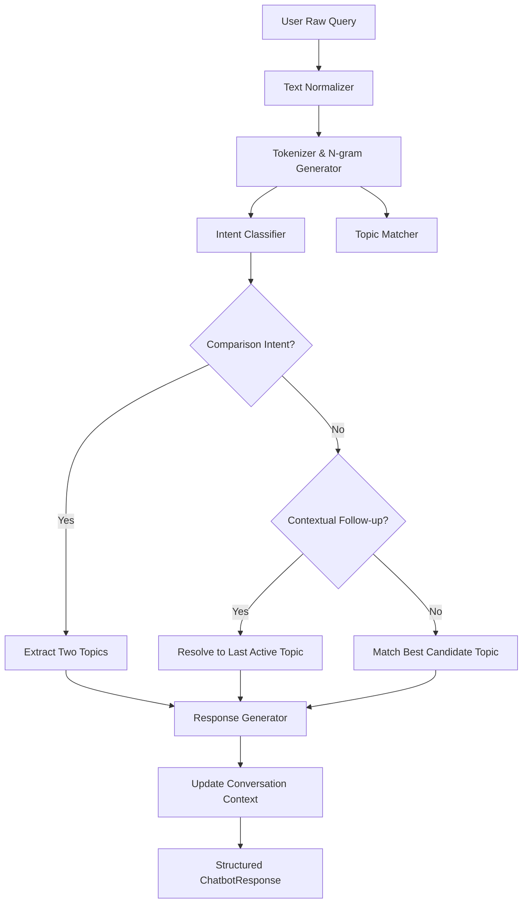

# AI KnowledgeBot Architecture & Technical Design

## 1. System Overview

**AI KnowledgeBot** is a deterministic, rule-based conversational AI engine and curriculum dashboard. It answers user questions regarding Artificial Intelligence without relying on Large Language Model APIs (e.g. OpenAI), cloud inference services, or neural language models.

### Core Architectural Principles:
1. **100% Deterministic Execution:** The same input under identical state always produces the exact same verified response.
2. **Zero Hallucination:** The system answers strictly from structured knowledge bases and predefined pedagogical templates. Unknown or out-of-scope questions trigger transparent fallback recommendations.
3. **Auditability & Explainability:** Every response outputs its matched rule, detected intent, confidence score, and context resolution details.
4. **Offline Capability:** Operates locally on Windows without requiring network connectivity or API tokens.

---

## 2. Request Processing Pipeline



### Stage 1: Text Normalization (`src/nlp/normalizer.py`)
- Strips typographic smart quotes (`“`, `”`, `‘`, `’`) and em-dashes (`—`).
- Applies Unicode NFKD decomposition to separate diacritics while preserving standard ASCII.
- Lowers case and collapses duplicate whitespace.
- Expands common English contractions (`what's` -> `what is`, `don't` -> `do not`, `it's` -> `it is`, `can't` -> `cannot`).
- Preserves domain-critical symbols:
  - Asterisk `*` attached to `a` (for `A*` search).
  - Hyphens in compound technical terms (`k-means`, `tf-idf`, `q-learning`).

### Stage 2: Tokenization & N-grams (`src/nlp/tokenizer.py`)
- Splits text into lexical tokens using regex `r"\ba\*|[a-zA-Z0-9]+(?:-[a-zA-Z0-9]+)*"`.
- Filters uninformative stopwords while preserving structural and intent keywords (`difference`, `between`, `and`, `what`, `why`, `how`, `formula`, `algorithm`, `steps`, `pros`, `cons`, `branches`).
- Generates n-grams (1-gram through 4-gram) to support multi-word alias matching (e.g., `named entity recognition`, `support vector machines`).

### Stage 3: Intent Classification (`src/engine/intent_classifier.py`)
Deterministic regex rules classify user intent into 17 supported categories:
- `GREETING`, `GOODBYE`, `HELP`
- `LIST_MODULES`, `LIST_TOPICS`
- `DEFINE_TOPIC`, `EXPLAIN_TOPIC`, `GIVE_EXAMPLE`
- `COMPARE_TOPICS`, `ADVANTAGES_LIMITATIONS`, `APPLICATIONS`
- `EXPLAIN_ALGORITHM`, `SHOW_FORMULA`, `RELATIONSHIPS`
- `RECOMMEND_TOPIC`, `REPEAT_CLARIFY`, `UNKNOWN`

### Stage 4: Multi-Tier Topic Matching (`src/engine/topic_matcher.py`)
- **Tier 1 (Exact Match):** Direct lookup in normalized alias table (`alias_to_id`).
- **Tier 2 (Special Acronyms):** Regex patterns with boundary checks for short ambiguous technical acronyms (`CNN`, `RNN`, `SVM`, `YOLO`, `A*`, `RAG`, `NLP`, `LLM`, `HMM`, `BFS`, `DFS`, `UCS`).
- **Tier 3 (N-Gram Window Matching):** Longest n-grams (4-grams down to 1-grams) tested against indexed aliases.
- **Tier 4 (Keyword Frequency Scoring):** Inverted index frequency scoring on content tokens.
- **Tier 5 (Fuzzy Search Fallback):** Lexical search across definitions and names.

### Stage 5: Context-Aware Follow-Up Handling (`src/engine/context_manager.py`)
Maintains session state across conversational turns:
- If a user asks *"What is AI?"*, the active topic is set to `ai_definition`.
- Subsequent follow-ups like *"What are its branches?"*, *"Give an example"*, or *"What are its limitations?"* resolve the pronoun *"it/its"* to `ai_definition`.
- *"Repeat that please"* retrieves the previous turn's response.

### Stage 6: Response Generation (`src/engine/response_generator.py`)
Formats rich educational markdown responses with:
- Topic Title, Category, and ID badges.
- Clear Definition block.
- In-depth Explanation section.
- Real-World Example callout.
- LaTeX mathematical formulas (e.g. TF-IDF, Bayes theorem, Cosine similarity, A* heuristic $f(n)=g(n)+h(n)$).
- Step-by-step algorithm procedures.
- Pros and Cons bullet points.
- Comparative side-by-side Markdown tables for comparison queries.
- Clickable suggested follow-up questions.

---

## 3. Directory Layout

```
d:\Lingo_AI\
├── app.py                      # Main Streamlit web application
├── requirements.txt            # Python dependencies
├── .gitignore                  # Git exclusions
├── README.md                   # Project documentation & run guide
├── knowledge_base/             # 8 modular JSON curriculum files
│   ├── module_a_fundamentals.json
│   ├── module_b_machine_learning.json
│   ├── module_c_deep_learning.json
│   ├── module_d_nlp.json
│   ├── module_e_computer_vision.json
│   ├── module_f_knowledge_based_ai.json
│   ├── module_g_search_planning.json
│   └── module_h_generative_ai.json
├── src/
│   ├── nlp/                    # Normalizer & Tokenizer
│   ├── engine/                 # Core rule engine & models
│   └── ui/                     # CSS styles, components, and quiz data
├── tests/                      # Automated test suite (45 unit & E2E tests)
└── docs/                       # Architecture, Knowledge Base & Testing guides
```
